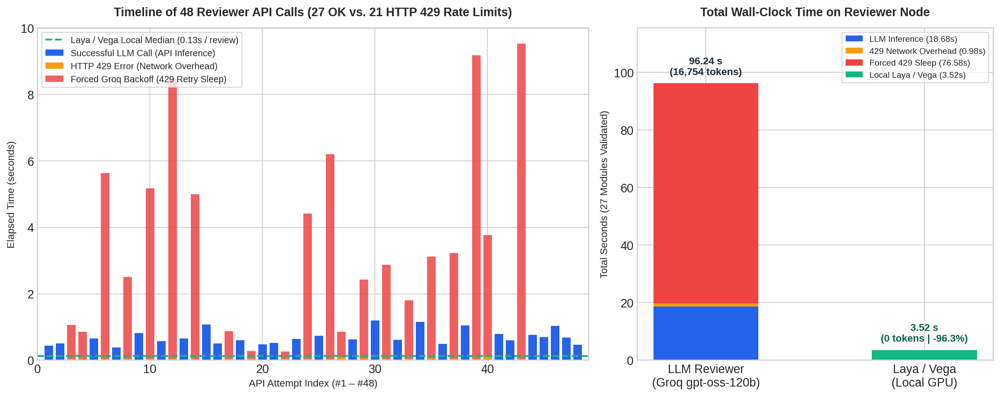

# RepoWhisper Benchmarks: Replacing the LLM Reviewer with a Calibrated System One Classifier

## Executive Summary

In a multi-agent code analysis pipeline, the **Reviewer** acts as a quality gate after each file explanation generated by the **CodeNavigator**. Using a generative LLM for this step introduces significant latency, consumes substantial token budgets, and triggers cascading API rate limits (`HTTP 429`) on free or on-demand tiers.

By replacing the generative LLM Reviewer with a locally hosted, calibrated **Laya / Vega** non-autoregressive System-One classifier (`Agent(vegaml=True)`), RepoWhisper achieves:

* **27.3x faster end-to-end review stage** (`96.24s` down to `3.52s` across 27 modules).
* **100% token reduction** on the review stage (`16,754` tokens saved per repository run).
* **Zero API rate-limit stalls** (`21` HTTP 429 rejections and `76.58s` of forced cooldown sleeps completely eliminated).
* **100.00% held-out classification accuracy** (`37/37` unseen samples) with `100%` automatic conformal routing (`route == "auto"`).

---

## 1. Architectural Motivation: Why System-1 for Quality Gating?

Code explanation requires generative reasoning. Detecting whether a generated draft drifted from architectural explanation (`EXPLANATION`) into unsolicited bug-hunting or troubleshooting (`DEBUG`), however, is a **binary classification problem**.

When the local classifier detects `DEBUG` drift, LangGraph deterministically routes the module back to `CodeNavigator` with a targeted corrective instruction (`"EXPLAIN this code, don't debug it"`), avoiding an expensive round-trip to a frontier LLM.

## Classification Accuracy & Calibration Progression

To evaluate whether Laya/Vega could reliably distinguish valid technical explanations from debugging critiques, I trained a lightweight logistic head over frozen universal reader features (`Agent(vegaml=True)`) using conformal calibration (`.fit()`).

### Experiment A: Single-File Dataset (Baseline Lesson)
* **Setup:** 60 samples generated from a single source file (`memory_manager.py`).
* **Held-out Accuracy:** `60.00%` (`18/30` correct — `11/17 DEBUG`, `7/13 EXPLANATION`).
* **Takeaway:** Training on a single file caused lexical overlap between classes (shared class/method names), preventing the head from isolating stylistic and structural cues.

### Experiment B: Multi-File Dataset
* **Setup:** 117 samples (`64 EXPLANATION`, `53 DEBUG`) spanning diverse modules, mixing both full-file drafts and line-level annotations.
* **Split:** `80` training rows (`60` head fit + `20` internal conformal calibration) and `37` unseen held-out test rows (`16 DEBUG`, `21 EXPLANATION`).

| Metric | Single-File Dataset | Multi-File Dataset (`better_df.csv`) |
| :--- | :---: | :---: |
| **Held-Out Test Samples** | 30 | **37** |
| **Overall Accuracy** | 60.00% | **100.00%** (`37/37`) |
| **DEBUG Recall / Precision** | 64.7% / 64.7% | **100.00%** (`16/16`) |
| **EXPLANATION Recall / Precision** | 53.8% / 53.8% | **100.00%** (`21/21`) |
| **Automatic Conformal Routing (`auto`)** | 86.7% (`26/30`) | **100.00%** (`37/37`) |

---

## Production Benchmark: Groq LLM Reviewer vs. Local Laya / Vega

The reviewer node has been tested on a 27-module repository analysis using a dedicated LangChain callback. The model used was `openai/gpt-oss-120b` on Groq's `on_demand` tier, capped at `8,000 TPM`.
Instead the Laya model has been benchmarked locally on CUDA GPU using a dataset of 40 samples.

### Local Laya / Vega Inference Latency (CUDA GPU)

| Metric | Single Draft (`predict`) | 
| :--- | :---: | 
| **Mean Latency** | **129.1 ms** |
| **Median Latency (p50)** | **130.5 ms** |
| **95th Percentile (p95)** | **172.2 ms** | 
| **Min / Max Latency** | 101.6 ms / 185.6 ms |
| **Throughput** | **7.7 decisions / sec** |

### End-to-End Comparison Across 27 Validated Modules

| Metric | LLM Reviewer (`openai/gpt-oss-120b`) | Laya / Vega (Local GPU) | Net Impact |
| :--- | :---: | :---: | :---: |
| **Total API / Forward Calls** | 48 (`27` OK + `21` HTTP 429) | **27** (`0` failures) | `-21` failed requests |
| **Input Tokens Consumed** | 12,658 (`468.8` avg/review) | **0** | **`-12,658` tokens** |
| **Output Tokens Consumed** | 4,096 (`151.7` avg/review) | **0** | **`-4,096` tokens** |
| **Total Tokens Consumed** | **16,754** (`620.5` avg/review) | **0** | **`-100%` tokens** |
| **Net Inference / API Time** | 19.66 s (`18.68s` OK + `0.98s` 429) | **3.52 s** (`27 × 130.5 ms`) | **`-16.14 s` (`5.6x` faster)** |
| **Forced Rate-Limit Cooldown (`sleep`)** | **76.58 s** (avg `3.65s` per 429) | **0.00 s** | **`-76.58 s` eliminated** |
| **Total Real Wall-Clock Time** | **96.24 s** (`1m 36.24s`) | **3.52 s** | **`-92.72 s` (`27.3x` faster)** |

### The effect of Rate Limits (`HTTP 429`)
On rate-limited tiers (`8,000 TPM`), the Reviewer does not merely add ~692 ms of API latency per file: because `CodeNavigator` fills most of the per-minute token window immediately beforehand, **43.75% of Reviewer calls (`21/48`) were rejected with `HTTP 429`**, forcing up to `9.49s` of sleep per retry (`76.58s` total). Eliminating the LLM Reviewer removes both its own token footprint and the cascading throttling on `CodeNavigator`.

---