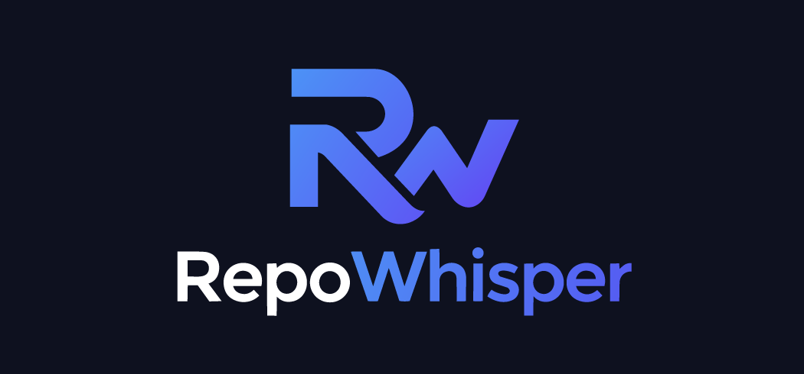

<div align="center">
  

  # RepoWhisper

  ### Turn an unfamiliar repository into your fastest onboarding companion.

  <p>
    
    
    
  </p>

  **Read the architecture. Explore every file. Learn with your model.**

  [PyPI](https://pypi.org/project/repowhisper/)
</div>

---

## A new codebase should not feel like a puzzle

Joining a company means entering projects that were started long before you arrived.

The architecture lives in people's heads. Documentation is outdated. Your first contribution begins with a long walk through files, imports and hidden assumptions.

**RepoWhisper gives you a starting map.**

Paste a GitHub repository URL, choose an AI model and user level, and get an interactive study experience covering the whole system—from architecture to individual lines.

Built for developers onboarding into real projects, students exploring open source, and curious engineers who want to understand code faster.

## One repository. Four specialists. One clear story.

RepoWhisper is a LangGraph pipeline where each agent has a precise role:

- **Architect** — maps the project structure and architectural boundaries.
- **Navigator** — explains each source file and highlights important lines.
- **Reviewer** — challenges weak explanations and sends them back for revision.
- **Storyteller** — turns the approved findings into a cohesive narrative.

The result is not a random code dump. It is a guided report that can be explored in a polished local interface.

## Your model. Your cost. Your control.

RepoWhisper accepts any LangChain-compatible chat model.

```text
Free local model  →  privacy, experimentation and offline-friendly workflows
Groq or another free tier  →  fast analysis with a low or zero API cost
OpenAI or Anthropic  →  premium reasoning when accuracy matters most
```

You decide the trade-off.

Choose **Junior** for detailed learning, **Mid** for balanced technical depth, or **Senior** for concise architectural insight.

> RepoWhisper is a workflow, not a model. Your model choice is the biggest factor in answer quality.

## What happens inside

1. **Clone** a public GitHub repository.
2. **Map** the project tree and Python dependency order.
3. **Architect** the system from grounded repository evidence.
4. **Navigate** every file and capture meaningful line-level insights.
5. **Review** the explanation and retry weak drafts.
6. **Tell the story** in a final architectural narrative.
7. **Study** the result in a browser.

## Use the context. Skip the premium tax.

Repository understanding tools can consume more than **150,000 tokens per analysis**. RepoWhisper lets you connect the same workflow to local models or providers with free tiers instead of locking you to one expensive option.

For `N` analyses, the provider-side saving can be estimated as:

```text
estimated saving = N × paid provider cost per analysis
                  - RepoWhisper provider cost
```

At 150,000 tokens per analysis:

| Analyses | Tokens consumed |
| ---: | ---: |
| 10 | 1.5 million |
| 100 | 15 million |
| 1,000 | 150 million |

Actual savings depend on the provider, model and plan. Free and local models can reduce cost, but may not match the reasoning quality of larger proprietary models.

## Get started in minutes

**Requirements:** Python 3.12, Git for remote repositories, and a LangChain-compatible provider.

### Install from PyPI

```powershell
python -m pip install repowhisper
```

Add the provider you want:

```powershell
python -m pip install "repowhisper[groq]"
python -m pip install "repowhisper[ollama]"
python -m pip install "repowhisper[openai]"
python -m pip install "repowhisper[anthropic]"
```

### Install for development

```powershell
git clone https://github.com/Andrea-Difino/RepoWhisper.git
cd RepoWhisper
uv sync --group dev
```

### Your first analysis

Create a `.env` file with the credentials for your provider:

```env
GROQ_API_KEY=your_key_here
```

Then inject the model into the RepoWhisper facade:

```python
import os

from dotenv import load_dotenv
from langchain_groq import ChatGroq
from pydantic import SecretStr
from repowhisper import RepoWhisper, UserLevel

load_dotenv()

llm = ChatGroq(
    api_key=SecretStr(os.environ["GROQ_API_KEY"]),
    model="openai/gpt-oss-20b",
    max_tokens=6000,
)

engine = RepoWhisper(
    source_target="https://github.com/owner/repository",
    llm=llm,
    user_level=UserLevel.MID,
)

engine.serve_ui()
```

That is it. RepoWhisper generates the report and opens the interface at `http://localhost:8543`.

Prefer JSON?

```python
report_json = engine.generate_documentation()
```

Provider setup and explanation levels: [Quick Start](https://github.com/Andrea-Difino/RepoWhisper/tree/main/docs/quickstart.md).

## The study experience

Every analysis becomes a navigable learning journey:

- executive summary;
- project structure;
- one slide per analyzed file;
- source code beside its explanation;
- line-level insights;
- keyboard navigation;
- studied-module tracking;
- a completion view.

The output is clean, typed JSON:

```json
{
  "title": "RepoWhisper Analysis",
  "tree_structure": "...",
  "narrative": "...",
  "raw_modules": [
    {
      "file": "src/example.py",
      "explanation": "...",
      "code_snippet": "...",
      "notes": {
        "12": "Important implementation detail"
      }
    }
  ]
}
```

See [Output Format](https://github.com/Andrea-Difino/RepoWhisper/tree/main/docs/output.md) and [Agents & Workflow](https://github.com/Andrea-Difino/RepoWhisper/tree/main/docs/agents.md).

## Know the current boundaries

RepoWhisper is actively evolving, and it is honest about its scope:

- supports remote **GitHub HTTP(S) URLs**;
- dependency analysis currently focuses on **Python imports**;
- large repositories take more time and tokens;
- output quality depends on the selected model;
- the interface is designed for local use.

Full details: [Limitations & Troubleshooting](https://github.com/Andrea-Difino/RepoWhisper/tree/main/docs/limitations.md).

## Built in the open. Maintained responsibly.

This project is maintained by one person alongside academic study. PRs are welcome, but sustainable PRs are small PRs.

Before submitting:

1. open an issue or describe the idea;
2. keep the change focused;
3. add tests for changed behavior;
4. run `uv run pytest -q`;
5. document public changes.

## Project links

- [Full documentation](https://github.com/Andrea-Difino/RepoWhisper/tree/main/docs)
- [Architecture](https://github.com/Andrea-Difino/RepoWhisper/tree/main/docs/architecture.md)
- [API reference](https://github.com/Andrea-Difino/RepoWhisper/tree/main/docs/api.md)
- [Limitations](https://github.com/Andrea-Difino/RepoWhisper/tree/main/docs/limitations.md)

## License

Distributed under the [MIT License](LICENSE).
