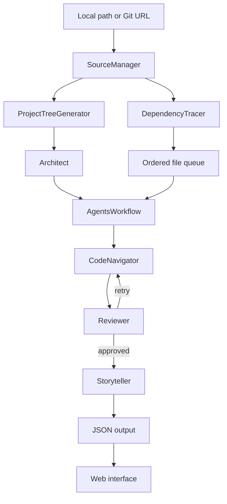

# System Overview

RepoWhisper is organized as a facade, source management layer, agent layer,
and orchestration layer.

## Execution phases

1. `SourceManager` resolves the source to a local path.
2. `Architect` receives the generated project tree.
3. `DependencyTracer` builds a dependency graph and processing order.
4. `CodeNavigator` explains each file and returns line-level notes.
5. `Reviewer` approves the explanation or requests a retry.
6. `Storyteller` combines the architecture and file explanations.
7. The final state is serialized to the documented JSON format.

The state contract is defined in
[orchestration/state.py](https://github.com/Andrea-Difino/RepoWhisper/blob/main/repowhisper/orchestration/state.py).
