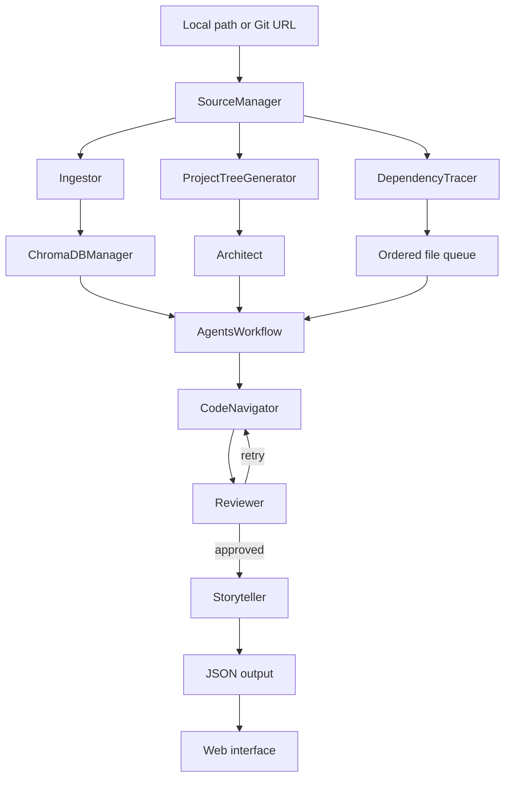

# System Overview

RepoWhisper is organized as a facade, ingestion layer, semantic memory layer,
agent layer, and orchestration layer.

## Execution phases

1. `SourceManager` resolves the source to a local path.
2. `Ingestor` parses supported files and creates document chunks.
3. `ChromaDBManager` embeds the chunks into a local Chroma store.
4. `Architect` receives the generated project tree.
5. `DependencyTracer` builds a dependency graph and processing order.
6. `CodeNavigator` explains each file and returns line-level notes.
7. `Reviewer` approves the explanation or requests a retry.
8. `Storyteller` combines the architecture and file explanations.
9. The final state is serialized to the documented JSON format.

The state contract is defined in
[orchestration/state.py](https://github.com/Andrea-Difino/RepoWhisper/blob/main/repowhisper/orchestration/state.py).
